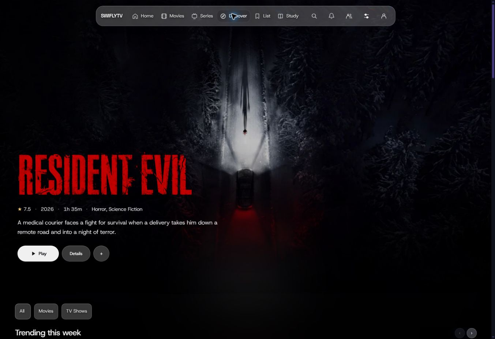
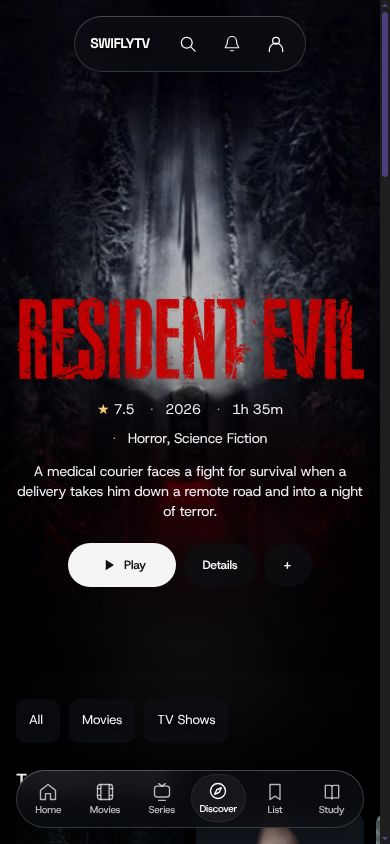
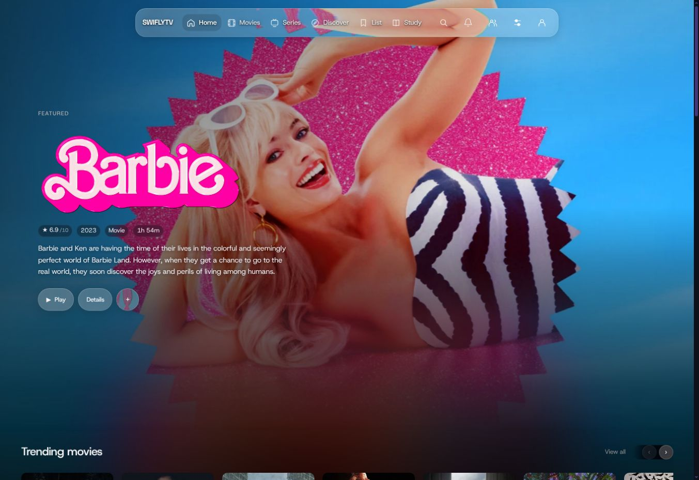
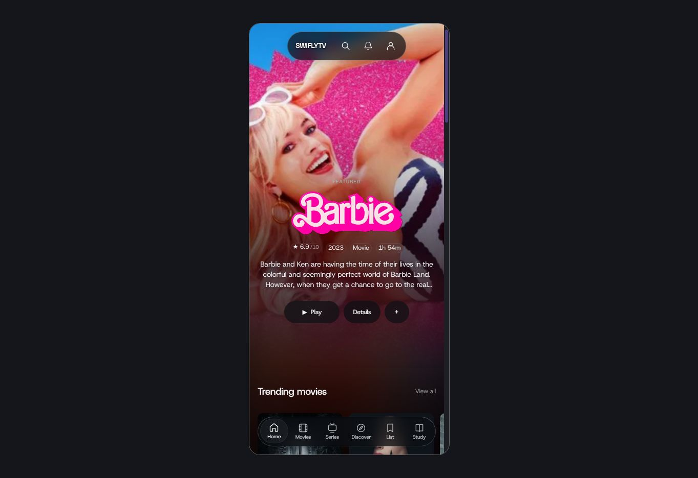

# Catalog polish verification

This PR repairs specific catalog loading, navigation and rendering defects while retaining glass, Aurora, Studio, profiles and playback features.

## Featured artwork and Studio follow-up — November 4

The latest pass follows the supplied Shuttle/Swifly reference: a lower feature composition, the selected title's real logo, plain rating/year/runtime/genre metadata, a bright Play action and a quieter continuation beneath the photograph. Discover leads into movie rows before the Surprise form. Movies, Series, Discover and Kids enrich only their selected hero through an optional 600 ms metadata lookup; failure preserves the selected title and usable actions.

Initial catalog entry now dissolves from pure black after visible artwork decodes. The 2.2 second safety deadline starts in the head and releases even when deferred scripts stall. Offscreen lazy posters do not delay entry; later artwork fades on decode. Copy and images fade independently of the glass controls' ancestors. Escape and history restoration release the surface. Reduced motion, TV/Xbox and Studio minimal/basic settings bypass it before deferred scripts finish. Studio artwork/Aurora styles retain their backgrounds, and explicit feature-loading holds retain their existing lifecycle.

Cinema now produces landscape cards, an explicit poster width controls rails independently of grid columns, and Save/reload/Cancel restore the rendered geometry. Compact/banner heroes, corners, spacing, Poster wall, quick actions and TV-safe rails are covered by real browser checks.

The captures below use the production shell with controlled catalog metadata and the public TMDB Resident Evil logo/backdrop observed on the reference site. Fixture IDs and repeated catalog items demonstrate layout rather than live catalog accuracy. The phone capture has a 390 px frame and 380 px content area due to the preview's desktop scrollbar; content and scroll width both measure 380 px.

Latest verification: syntax checks passed; **51 unit checks and 34 real Chromium checks passed** with no skips. The browser selection covers artwork readiness/deadline/decode fades, stalled scripts with comfort settings, full-shell poster CSS, 1920/1440/390/320 px layouts, 120% text, refractive/native secondary actions, Studio choices, native navigation and history. The broader scroll fixture passed 30 of 31 cases in a combined run; its wheel-frame-count timing assertion passed unchanged in isolation. The earlier Play refraction expectation was updated to check the intentionally bright primary action while retaining pixel-based refraction checks on secondary actions. Independent review findings about early comfort settings, the nested star badge and tablet logo alignment are fixed and covered.

No preview fixture, responsive test page or dev-command override is included in the branch. These changes have not been merged or deployed.

## Delivered changes

- The homepage requests seven stylesheets instead of 37. Fixed startup bundles retain stylesheet order, rebase relative URLs, use content hashes and keep older recognized bundle hashes usable across rolling deployments.
- Initial catalog entry uses the bounded artwork dissolve described above. Native navigation keeps its existing nonblocking progress state. Empty personal rows stay hidden until they have useful content; profile switches clear stale cards.
- Repeated slow glides contribute to a bounded recovery budget, while healthy scrolling retains the existing curve. Native fallback activates only after a glide settles.
- Search keeps current results during edits and replaces them atomically, with updating/error feedback and keyboard focus restored to the matching destination or input.
- Catalog arrows announce their actual boundaries without losing keyboard focus; controls hide when their rail fits. They update from horizontal scroll and resize rather than page scrolling.
- Episode initialization inspects inserted episode subtrees rather than rescanning the document after unrelated artwork, glass or search changes. Removed panels cancel their request.
- Featured titles use available English/neutral artwork from the existing bounded metadata lookup. Wrapped fallback text remains in layout, including at larger Studio text sizes, so artwork arrival does not move the metadata.
- Details use one 360ms entrance and 220ms exit. Detail sections remain immediately readable during scrolling. The library-page controller is only delivered to pages that use it.

## Earlier catalog preview observations

The managed preview ran production Express routes, styles and controllers with deterministic catalog metadata because live TMDB access was unavailable in the preview. Repeated titles and shared dates are fixture data. The featured backdrop and poster URLs came from the public catalog; the preview logo uses the Warner Bros./Mattel film logo distributed on [Wikimedia Commons](https://commons.wikimedia.org/wiki/File:Barbie_(2023_movie_logo).png). These screenshots demonstrate layout, not current catalog accuracy. No fixture server, responsive test page or dev-command override is included in the change.

- Desktop: featured artwork and glass actions are visible; initial row arrows correctly announce the left boundary.
- Mobile: a 390px iframe has a 380px content area with the desktop scrollbar; content width and scroll width both measure 380px.
- Automated Chromium checks cover a long featured title at 120% text size at 360px, 768px and 1920px with TV layout, before and after logo loading. The title and metadata retain their positions.

## Earlier catalog verification

Syntax checks passed. Focused controller regressions passed 28/28; the new real Chromium regressions passed 2/2. They exercise retained search results and focus, row-boundary focus, wrapped title layout, local episode initialization and conditional asset delivery. Independent review found and verified fixes for search focus loss, row-arrow focus loss and scaled fallback-title overlap.

GitHub check run 1187 passed on implementation commit 2138deadfa6919cc56c864ab173a57ff0e6d0d81: **1,524 non-browser checks and 211 Chromium checks passed**, followed by successful recommendation and acceptance checks. The four on-device model cases that lacked local prepared assets were exercised with prepared assets in CI.

The local full run completed 1,735 cases: 1,730 passed, four model cases skipped, and one catalog fixture exceeded its 10-second readiness deadline before reaching the hover assertions. That case passed in isolation. Its fixture now uses the same condition-based readiness check with a 30-second cold-start budget; no hover assertion was relaxed. All 31 cases in the affected browser fixture then passed, including the hover case. A final header-controls regression also verifies computed `display:none` in the actual header layout, and both focused Chromium tests pass.

The older hero-animation expectation was updated to the intended immediately readable behavior; sheet timing and detail reveal expectations now match the new transitions. GitHub runs the new browser cases after installing Chromium.

## Limits

The preview uses controlled data and does not certify Safari, physical iPad/Xbox performance, media-source availability or playback. No FPS increase or production latency reduction has been measured. The changes reduce specific loading, layout and rendering work; they do not claim every existing feature is fully polished.
