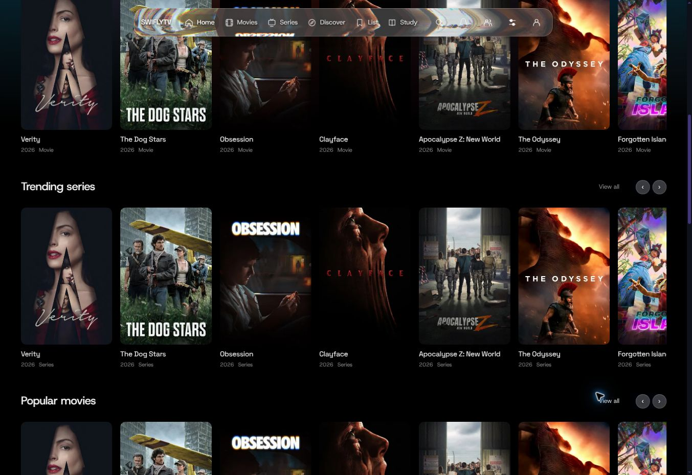
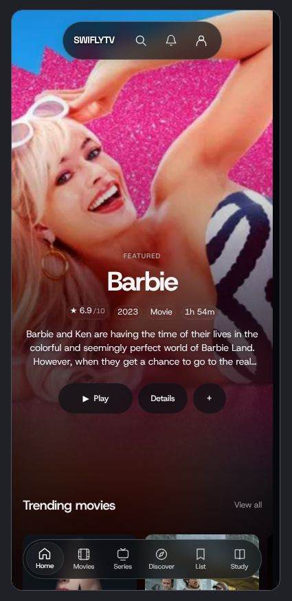

# Catalog polish verification

The homepage now requests seven stylesheets, down from 37, while preserving the cascade around welcome, auth, party and player styles. The bundles are built at startup and use content hashes. Recognized older hashes receive compatible current CSS without caching, so an HTML response crossing a rolling deployment stays styled.

## Browser observations

The production Express routes and shared controllers were run in a temporary managed preview. The preview did not have working live TMDB access, so catalog responses used deterministic metadata with public artwork URLs observed on the live homepage. Repeated titles in the desktop capture are fixture data. No fixture server, preview page or dev-command override is included in this change.

- Desktop: the first poster and its title are fully visible; both empty personal rows have `display: none`; the bell has no nested optical pane; hero title animation is `none`; seven stylesheet links are present.
- Mobile: a 390px iframe (380px content area with the desktop scrollbar) shows the hero, compact header and bottom navigation without horizontal document overflow.
- Minimal, artwork and aurora navigation loaders: the canvas and brand compute to `display: none`, the overlay background is transparent, pointer events are disabled, and the status remains in a clipped 1px region for accessibility.

## Automated checks

Final command: `npm run check && npm run test:ui`.

`npm run check` passed. The full test run completed with **1,519 passed, 0 failed, 209 skipped** (1,728 total). The skipped cases require an unavailable local Chromium browser. After the full run, three additional browser-fixture asset readers were adapted for virtual bundles; their 31 cases parse successfully and remain skipped for the same reason.

New regressions cover server-rendered content during slow deferred scripts, cold stylesheet requests and relative URL rebasing, stale-hash rollout fallback, profile feed visibility and keyboard focus under custom row placement, short repeated slow gestures, healthy-frame recovery and fallback only after a glide settles. Existing integration assertions and browser fixtures now understand the delivered bundles.

An independent read-only review found no remaining code issues after the rollout, loader, focus and scrolling fixes. `git diff --check` passed.

## Limits

The local Playwright browser suite could not run because Chromium is not installed in this environment. The separate cloud-browser checks above cover the changed visual surfaces; they are not a Safari, iPad, Xbox or playback certification. No FPS increase or live server latency reduction has been measured. This PR reduces stylesheet requests and fixes specific loading, layout and scroll-recovery defects; it does not claim every existing feature is fully polished.
